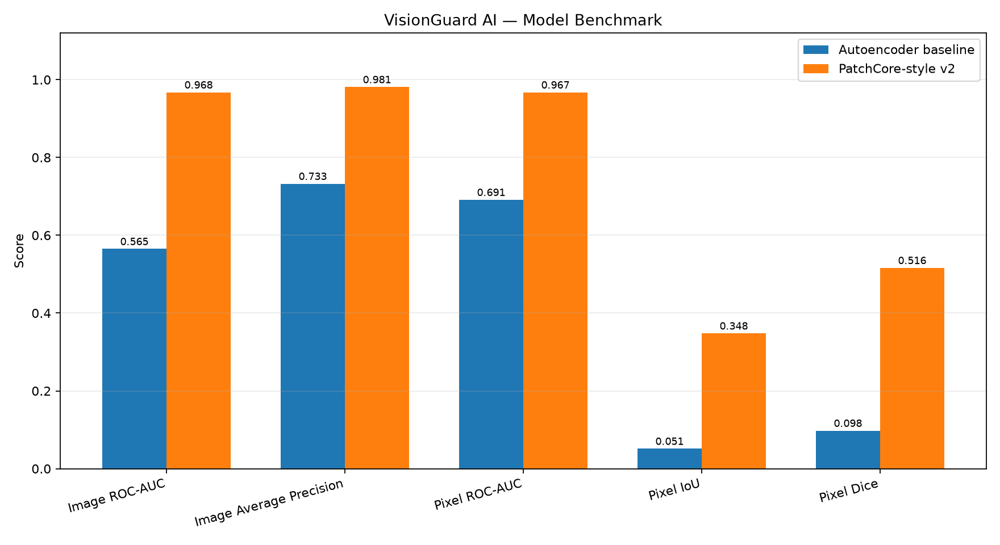

# VisionGuard AI — Model Benchmark Report

## 1. Objective

Compare a reconstruction-based convolutional autoencoder with a pretrained ResNet18 nearest-neighbour, PatchCore-style anomaly detection approach.

## 2. Dataset and evaluation

- Category: MVTec AD bottle.
- Training split: 48 normal images.
- Validation split: 12 normal images.
- Normal test images: 11.
- Defect test images: 14.
- Defect images with matched masks for localization: 14.
- The PatchCore-style memory bank was built from training images only.
- Image threshold: 95th percentile of validation image scores.
- Pixel threshold: 99.5th percentile of validation normal-image anomaly-map values.
- The held-out test set is used for final reported metrics, not threshold selection.

## 3. Model comparison

| Metric | Autoencoder baseline | PatchCore-style v2 |
|---|---:|---:|
| Image ROC-AUC | 0.5649 | 0.9675 |
| Image Average Precision | 0.7325 | 0.9812 |
| Pixel ROC-AUC | 0.6912 | 0.9674 |
| Pixel IoU | 0.0514 | 0.3479 |
| Pixel Dice | 0.0977 | 0.5162 |

## 4. PatchCore-style classification at the calibrated threshold

- Image threshold: 0.1720.
- Pixel threshold: 0.3752.
- True negatives: 7.
- False positives: 4.
- False negatives: 1.
- True positives: 13.

## 5. Methodology notes

- The autoencoder reconstructs an input image and uses reconstruction error as an anomaly signal.
- The PatchCore-style approach extracts pretrained ResNet18 layer-3 features, normalizes patch descriptors, and measures nearest-neighbour distances to a normal-training memory bank.
- The implementation is PatchCore-style, not a reproduction of every component of the original PatchCore algorithm.
- Pixel localization metrics are computed over defect test images with matched ground-truth masks. They should not be interpreted as a full normal-plus-defect pixel benchmark.
- Pixel IoU and Dice use a threshold calibrated from validation normal images.

## 6. Limitations

- The test set is small; the results have substantial sampling uncertainty.
- Only the bottle category is evaluated in this experiment.
- False positives remain possible at the current image threshold.
- Heatmaps are approximate localization maps and may not precisely trace defect boundaries.
- Results do not establish production readiness or generalization to other products, cameras, lighting conditions, or manufacturing environments.
- The dataset's license must be reviewed before any commercial use.

## 7. Conclusion

Use the measured comparison above to select the current research baseline. The PatchCore-style model is a promising candidate on this experiment, but further validation on more images and additional categories is needed before making broad accuracy claims.

## 8. Generated files

- `model_comparison.csv` — comparison metrics.
- `figures/model_comparison.png` — comparison chart.
- The original baseline and PatchCore-style evaluation files remain unchanged.
